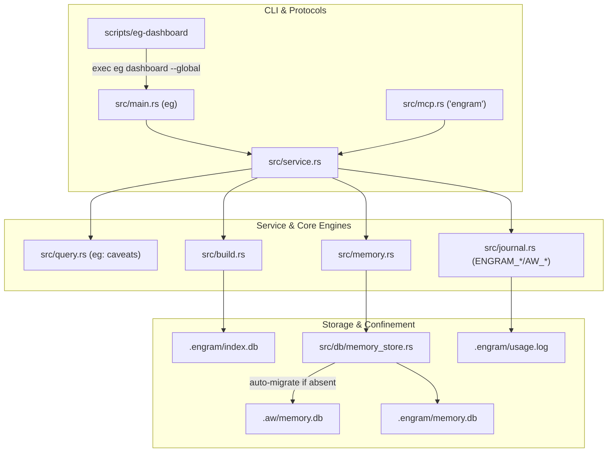

# Design Spec: Engram Codebase Rename (`agent-weave` / `aw` -> `engram` / `eg`)

- **Author**: Antigravity Core & Spec Team
- **Status**: Proposed (Gate 1 Approved, Post 4-Lens Brainstorm Synthesis)
- **Date**: 2026-11-09
- **Predecessor Artifact**: [`docs/archive/designs/2026-11-09_concepts-brief_engram-codebase-rename.md`](2026-11-09_concepts-brief_engram-codebase-rename.md)

---

## Overview

This specification formalizes the comprehensive, deterministic rename of the repository from `agent-weave` (`aw`) to `engram` (`eg`). It preserves the **Single Native Binary** architecture (`eg`), updates all AST/meta prefixes, switches storage confinement to `.engram/` and `~/.engram/`, transitions MCP server identity to `"engram"` (`⚡ eg:`), updates the routing skill to `skills/engram-first`, and incorporates critical security/compatibility mitigations identified during multi-lens review.

---

## The Problem

The tool suite previously operated under the name `agent-weave` (`aw`). Rebranding to `engram` (`eg`) aligns the codebase identity with human and agent memory concepts while maintaining concise terminal ergonomics. An ad-hoc rename risks:
1. Silent abandonment of primary user memories (`memory.db`) stored under `.aw/`.
2. Immediate failure of active MCP connections in agent environments (Antigravity, Grok, Claude, etc.).
3. Silent bypass of privacy opt-out flags (`AW_NO_JOURNAL`).
4. Untrusted memory injection vulnerabilities from repo-committed `.engram/` databases.
5. Symlink traversal vulnerabilities during cache invalidation.

---

## Goals

- **G-1 Single Native Binary Preservation**: The crate compiles strictly into one primary CLI binary (`eg`), housing all subcommands (including `eg dashboard` and `eg monitor`). Zero extra compiled binaries.
- **G-2 Deterministic Namespace Mapping**:
  - Package & Crate: `agent-weave` / `agent_weave` -> `engram`
  - CLI Binary: `aw` -> `eg`
  - Dashboard Shortcut Script: `scripts/aw-dashboard` -> `scripts/eg-dashboard`
  - Local Confinement: `.aw/` -> `.engram/`
  - Global Confinement: `~/.aw/` -> `~/.engram/`
  - Environment Prefix: `AW_*` -> `ENGRAM_*` (with backward fallback)
  - MCP Key & Footer: `"engram"`, `⚡ eg:`
  - Skill Directory: `skills/engram-first`
- **G-3 Zero Data Loss Migration**: If `.engram/memory.db` is absent but `.aw/memory.db` exists, automatically and atomically migrate primary notes with SQLite integrity validation.
- **G-4 Defensive Confinement & Permission Hardening**:
  - Enforce `0700` directory and `0600` file modes on `~/.engram/` on Unix hosts.
  - Reject repo-committed `.engram/` files to prevent prompt injection.
  - Safe symlink unlinking in `doctor --invalidate` without directory traversal.
- **G-5 Seamless Agent Host Interop**: `scripts/install.sh` establishes transitional symlinks (`aw -> eg`) and registers both `"engram"` and `"agent-weave"` MCP entries.

---

## Non-Goals

- Migrating `.aw/index.db` cache: indexes are disposable and rebuilt instantly (~0.02s) via `eg build`.
- Renaming historical git tags or past release assets.
- Changing graph traversal algorithms, query semantics, or FTS ranking formulas.

---

## Open Questions

- None. All architecture choices, mappings, and Goldfish review findings are reconciled.

---

## Critical User Journeys

### CUJ 1: Primary Developer Workflow (Fresh & Incremental Navigation)
- **Given**: A Git repository without prior index state.
- **When**: Developer runs `eg build`, followed by `eg callers <name>` and `eg search <term>`.
- **Then**: Index is compiled into `.engram/index.db` in <0.1s. Query outputs emit `eg: ...` prefixes and sub-2ms pointer results with zero external network activity.

### CUJ 2: Legacy Migration & Agent Memory Preservation
- **Given**: A workspace with existing notes in `.aw/memory.db` and machine-wide notes in `~/.aw/memory.db`.
- **When**: Developer installs `eg` and an agent runs `eg mem query "architecture"`.
- **Then**: `eg` detects missing `.engram/memory.db`, safely migrates `.aw/memory.db`, validates database integrity, and returns historical notes seamlessly without data loss.

### CUJ 3: Adversarial Repo-Planted Memory Injection
- **Given**: A malicious repository with an attacker-committed `.engram/memory.db` tracked in Git.
- **When**: An agent runs `eg mem query` or `eg build`.
- **Then**: `eg` detects that `.engram/memory.db` is tracked in Git, aborts with exit code 2, and prints `eg: security: .engram/ contains git-tracked files — untrack and remove to prevent malicious memory injection`.

---

## Technical Plan



---

## Alternatives Considered

### Alternative A: Dual Binaries in `Cargo.toml` (`eg` and `eg-dashboard`)
- **Pros**: `cargo install` compiles both executables directly into `~/.cargo/bin`.
- **Cons**: Violates the single-native-binary architectural invariant; adds dead-code boilerplate in `src/bin/`.
- **Reason for Rejection**: The owner explicitly selected Option 1 to keep the architecture minimal and unified. `eg dashboard` natively handles all dashboard execution.

### Alternative B: Big-Bang Hard Cut without Legacy Fallback
- **Pros**: Shortest code diff; zero backward-compatibility helper logic.
- **Cons**: Severely damages existing installations; drops primary developer memories; breaks active MCP agents.
- **Reason for Rejection**: Rejected by unanimous Goldfish reviewer consensus under Data Integrity and Ergonomics.

---

## Non-Functional Requirements

- **Security & Privacy**:
  - Unix permissions: `0700` on `~/.engram/`, `0600` on `usage.log` and `memory.db`.
  - Symlink traversal guard in `doctor.rs::clear_eg_dir` (`fs::symlink_metadata`).
  - Git-tracking check (`git ls-files .engram`) before trusting repo-local stores.
- **Performance & Latency**: Zero overhead added to the fast path; memory migration executes only on cold starts when `.engram/memory.db` is missing.
- **Rollout & Compatibility**:
  - Environment variable fallback: `ENGRAM_*` -> `AW_*`.
  - Script launcher `scripts/install.sh` creates symlink `aw -> eg` during transition.

---

## Detailed Implementation Plan

### File Ledger

#### [`Cargo.toml`](file:///Users/quy.doan/Workspace/kg/Cargo.toml) (Modify)
- Scope: Package manifest
- Change: `[package] name = "engram"`, `[lib] name = "engram"`, `[[bin]] name = "eg" path = "src/main.rs"`. Update URLs to `dmoreq/engram`.
- Rationale: Core crate and package rename. Strictly one binary.

#### [`scripts/aw-dashboard`](file:///Users/quy.doan/Workspace/kg/scripts/aw-dashboard) (Delete) / [`scripts/eg-dashboard`](file:///Users/quy.doan/Workspace/kg/scripts/eg-dashboard) (Create)
- Scope: Dashboard launcher script
- Change: Renamed to `scripts/eg-dashboard`. Updated to resolve `eg` binary and run `exec eg dashboard --global "$@"`.
- Rationale: Preserves convenience launcher shortcut without adding a second Rust binary.

#### [`.gitignore`](file:///Users/quy.doan/Workspace/kg/.gitignore) (Modify)
- Scope: Git exclusion
- Change: Add `.engram/` alongside `.aw/`.
- Rationale: Prevent accidental tracking of local index and memories.

#### [`tests/scripts/allowlist.txt`](file:///Users/quy.doan/Workspace/kg/tests/scripts/allowlist.txt) (Modify)
- Scope: Dependency allowlist
- Change: Replace `agent-weave` with `engram`.
- Rationale: Pass `tests/scripts/allowlist_check.sh`.

#### [`build.rs`](file:///Users/quy.doan/Workspace/kg/build.rs) (Modify)
- Scope: Compiler build script
- Change: Emit `cargo:rustc-env=ENGRAM_GRAMMAR_VERSION={value}`.
- Rationale: Update compiler environment variable.

#### [`.github/workflows/ci.yml`](file:///Users/quy.doan/Workspace/kg/.github/workflows/ci.yml) & [`.github/workflows/release.yml`](file:///Users/quy.doan/Workspace/kg/.github/workflows/release.yml) (Modify)
- Scope: CI/CD automation
- Change: Update binary paths from `target/release/aw` to `target/release/eg`, archive names to `eg-*`.
- Rationale: Ensure CI/CD gates test and package the renamed binary.

#### [`scripts/install.sh`](file:///Users/quy.doan/Workspace/kg/scripts/install.sh) & [`install.sh`](file:///Users/quy.doan/Workspace/kg/install.sh) (Modify)
- Scope: Multi-agent installer
- Change: Compile `eg`, symlink `eg` and `eg-dashboard`, create transitional `aw` symlink, register `"engram"` MCP server, grant `mcp(engram/*)` permissions, deploy `skills/engram-first`.
- Rationale: Multi-agent ecosystem provisioning.

#### [`src/lib.rs`](file:///Users/quy.doan/Workspace/kg/src/lib.rs) & [`src/main.rs`](file:///Users/quy.doan/Workspace/kg/src/main.rs) (Modify)
- Scope: Library root & CLI entrypoint
- Change: `use engram::...`, update panic prefix to `"eg: internal: ..."`.
- Rationale: Crate identity alignment.

#### [`src/error.rs`](file:///Users/quy.doan/Workspace/kg/src/error.rs) (Modify)
- Scope: Error taxonomy
- Change: Rename `AwError` -> `EgError` (alias `pub type AwError = EgError;`), update `Display` strings to `"eg: ..."` and `CORRUPT_INDEX_MSG` to `"run eg build"`.
- Rationale: CLI/MCP error contract compliance.

#### [`src/cli.rs`](file:///Users/quy.doan/Workspace/kg/src/cli.rs) (Modify)
- Scope: Command-line interface definitions
- Change: Set `name = "eg"`, update `about` and `long_about` mentioning `.engram/`, add alias `memory` to `mem` subcommand.
- Rationale: CLI command mapping and ergonomics.

#### Database Subsystem ([`src/db.rs`](file:///Users/quy.doan/Workspace/kg/src/db.rs), [`src/db/meta.rs`](file:///Users/quy.doan/Workspace/kg/src/db/meta.rs), [`src/db/memory_store.rs`](file:///Users/quy.doan/Workspace/kg/src/db/memory_store.rs), [`src/db/query_state.rs`](file:///Users/quy.doan/Workspace/kg/src/db/query_state.rs)) (Modify)
- Scope: Storage and memory lifecycle
- Change:
  - Add `pub fn eg_dir(root: &Path) -> PathBuf { root.join(".engram") }` (aliased as `aw_dir`).
  - Add `pub fn global_eg_dir() -> Result<PathBuf> { ... }`.
  - In `open_memory_store` / `open_global_memory_store`: if `.engram/memory.db` is missing but `.aw/memory.db` exists, atomically migrate notes and check integrity.
  - Implement Git-tracking provenance check on `.engram/`.
  - Set `0700`/`0600` permissions on Unix.
  - Read `ENGRAM_GLOBAL_DIR`, falling back to `AW_GLOBAL_DIR`.
  - Update `ENGRAM_VERSION` and `ENGRAM_GRAMMAR_VERSION`.
- Rationale: Confinement, security hardening, and zero-loss memory migration.

#### [`src/walk.rs`](file:///Users/quy.doan/Workspace/kg/src/walk.rs) (Modify)
- Scope: File enumeration
- Change: Filter out `.engram` and `.aw` using strict path segment equality (`seg == ".engram" || seg == ".aw"`).
- Rationale: Ignore confinement directories while allowing application code like `src/engram/`.

#### Journal Subsystem ([`src/journal.rs`](file:///Users/quy.doan/Workspace/kg/src/journal.rs), [`src/journal/tokens.rs`](file:///Users/quy.doan/Workspace/kg/src/journal/tokens.rs), [`src/journal/render.rs`](file:///Users/quy.doan/Workspace/kg/src/journal/render.rs)) (Modify)
- Scope: Telemetry and audit log
- Change: Fallback resolution for `ENGRAM_NO_JOURNAL` -> `AW_NO_JOURNAL`, `ENGRAM_SESSION` -> `AW_SESSION`. Path: `.engram/usage.log` and `~/.engram/usage.log`. Read legacy entries if present. Headers: `"eg usage: ..."`, `"eg global usage: ..."`.
- Rationale: Telemetry continuity and privacy protection.

#### Protocol & Service ([`src/mcp.rs`](file:///Users/quy.doan/Workspace/kg/src/mcp.rs), [`src/mcp/format.rs`](file:///Users/quy.doan/Workspace/kg/src/mcp/format.rs), [`src/service.rs`](file:///Users/quy.doan/Workspace/kg/src/service.rs), [`src/service/tools.rs`](file:///Users/quy.doan/Workspace/kg/src/service/tools.rs)) (Modify)
- Scope: MCP server & service dispatch
- Change: `serverInfo.name`: `"engram"`, footer: `⚡ eg:`, parameter docs: `.engram/` and `~/.engram/`.
- Rationale: Protocol identity and KPI footer parity.

#### Query Subsystem ([`src/query.rs`](file:///Users/quy.doan/Workspace/kg/src/query.rs), [`src/query/**/*.rs`](file:///Users/quy.doan/Workspace/kg/src/query)) (Modify)
- Scope: Graph traversal & analysis
- Change: Update all caveats and hint strings from `aw:` to `eg:` (`eg: path — ...`, `eg: context — ...`, `eg: impact — ...`, `eg: reuse-hint: ...`).
- Rationale: Consistent output contracts.

#### Telemetry, Doctor & Web UI ([`src/insights.rs`](file:///Users/quy.doan/Workspace/kg/src/insights.rs), [`src/doctor.rs`](file:///Users/quy.doan/Workspace/kg/src/doctor.rs), [`src/memory.rs`](file:///Users/quy.doan/Workspace/kg/src/memory.rs), [`src/dashboard/assets/app.js`](file:///Users/quy.doan/Workspace/kg/src/dashboard/assets/app.js)) (Modify)
- Scope: Diagnostics, memories, and dashboard client
- Change: Fix symlink traversal in `doctor.rs::clear_eg_dir`. Update doctor strings (`eg: doctor ...`). Update JS assets to `.engram/index.db`.
- Rationale: Operational diagnosability and UI parity.

#### Integration Tests & Harness ([`tests/cli/**/*.rs`](file:///Users/quy.doan/Workspace/kg/tests/cli), [`tests/mcp/**/*.rs`](file:///Users/quy.doan/Workspace/kg/tests/mcp), [`tests/fixtures/**/*.rs`](file:///Users/quy.doan/Workspace/kg/tests/fixtures)) (Modify)
- Scope: Test verification suite
- Change:
  - In `tests/cli/common.rs`: use `env!("CARGO_BIN_EXE_eg")`, `ENGRAM_GLOBAL_DIR`, helper `fn eg(...)`.
  - In `tests/mcp/common.rs`: assert server name `"engram"`, strip `⚡ eg:`.
  - Update all test invocations and assertions (`aw` -> `eg`, `.aw` -> `.engram`).
  - Update crate imports: `use engram::...`.
- Rationale: Maintain 100% test passing gate under renamed contracts.

#### Verification Scripts ([`tests/scripts/hygiene_check.sh`](file:///Users/quy.doan/Workspace/kg/tests/scripts/hygiene_check.sh), [`tests/scripts/write_path_check.sh`](file:///Users/quy.doan/Workspace/kg/tests/scripts/write_path_check.sh), Python benchmarks) (Modify)
- Scope: Automated invariant checks
- Change: Update `hygiene_check.sh` to allow `⚡ eg:`. Update `write_path_check.sh` probe strings. Update `bench/run.py` to test `target/release/eg`.
- Rationale: Pass all repository invariant verification gates.

#### Skill Directory: `skills/aw-first` (Delete) / [`skills/engram-first`](file:///Users/quy.doan/Workspace/kg/skills/engram-first) (Create)
- Scope: Agent routing policy
- Change: Move folder to `skills/engram-first`. Update `skills/engram-first/SKILL.md` frontmatter to `name: engram-first` and command references to `eg`.
- Rationale: Agent skill identity parity.

#### Documentation ([`README.md`](file:///Users/quy.doan/Workspace/kg/README.md), [`AGENTS.md`](file:///Users/quy.doan/Workspace/kg/AGENTS.md), [`docs/*.md`](file:///Users/quy.doan/Workspace/kg/docs), etc.) (Modify)
- Scope: Public documentation & repository rules
- Change: Update title `# engram (\`eg\`)`, insert exact character-aligned diagram in `README.md`, update `AGENTS.md` rules and CLI references across all documentation pages.
- Rationale: Documentation accuracy and completeness.

---

### Verification Plan

#### Automated Verification Commands
```sh
# 1. Format check
cargo fmt --all -- --check

# 2. Strict lints
cargo clippy --all-targets -- -D warnings

# 3. Unit and integration test suite
cargo test --locked

# 4. Repository safety & invariant gates
bash tests/scripts/allowlist_check.sh Cargo.lock
bash tests/scripts/write_path_check.sh
bash tests/scripts/hygiene_check.sh

# 5. Public navigation regression benchmarks
python3 -I bench/test_run.py
cargo build --locked --release
python3 -I bench/run.py target/release/eg
```

#### Manual Verification Acceptance Gates
1. Run `target/release/eg --help`: Verify binary self-identifies as `eg` with consultative confinement to `.engram/`.
2. Run `target/release/eg build`: Verify repository builds cleanly into `.engram/index.db`.
3. Run `scripts/eg-dashboard --help`: Verify launcher executes `eg dashboard --global`.
4. MCP handshake: Connect via stdio and assert `{"serverInfo": {"name": "engram"}}` and `⚡ eg:` KPI footer.
